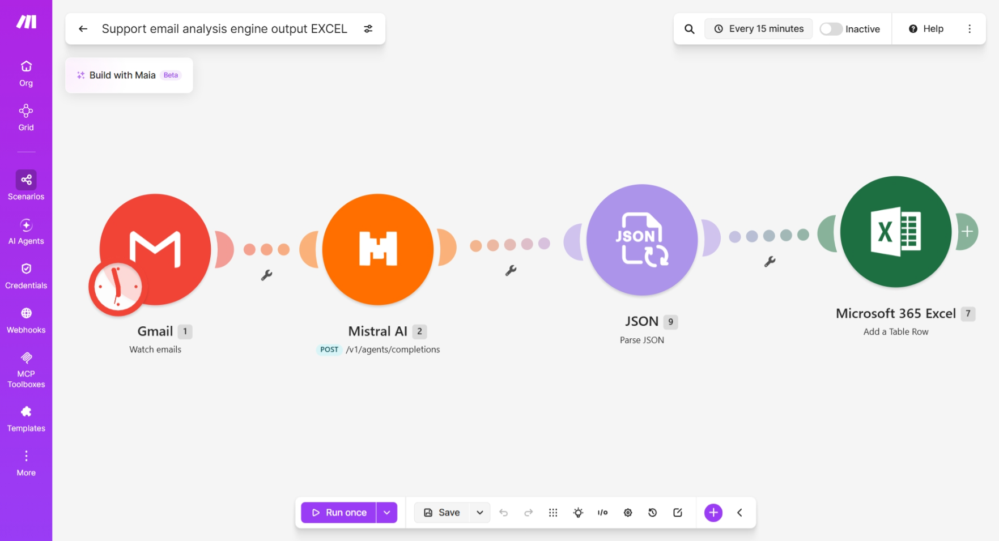

# Support Email Analysis Engine (output: Excel)

A scenario that reads incoming customer support emails, uses a Mistral AI agent to extract the key information (customer, order, issue type, urgency, requested action...), and logs each email as a row in an Excel table.

Other versions of this scenario:
- [Support-email-analysis-engine-output-Google-Sheets](https://github.com/phillarr/Support-email-analysis-engine-output-Google-Sheets)
- [Support-email-analysis-engine-output-Notion](https://github.com/phillarr/Support-email-analysis-engine-output-Notion)

## The scenario



```
Gmail (new email) ──► Mistral AI agent (extract as JSON) ──► Parse JSON ──► Excel (add table row)
```

## What it does

1. **Watch new emails** (Gmail): checks your inbox for new messages.
2. **Analyze the email** (Mistral AI, API call to `/v1/agents/completions`): sends the subject and body to a Mistral **agent**. The agent's instructions ([`prompt.md`](prompt.md)) tell it to extract only what is explicitly written, keep the original wording, and return `null` for missing fields:
   - `CustomerName`: a clearly stated name, preferably the signature (not taken from the email address)
   - `OrderNumber`: an order, reference or ticket number
   - `TrackingNumber`: a shipment tracking number
   - `IssueType`: `delivery`, `billing`, `product`, `refund` or `other`
   - `RequestedAction`: what the customer explicitly asks for
   - `UrgencyLevel`: `high`, `medium` or `low`
   - `CustomerSince`: a date or year explicitly given for the customer relationship (for example "customer since 2021")
   - `ProductMentioned`: the main product mentioned
3. **Parse JSON**: removes any Markdown code fences and turns the agent's reply into structured data.
4. **Add a table row** (Microsoft 365 Excel): logs the analysis with a timestamp.

> **The AI can make mistakes.** It can mix up an order number and a tracking number, pick the wrong issue type or misjudge urgency. Use the table to sort and prioritize, but check the original email before answering the customer.

## Requirements

- A Make.com account (the free plan is enough to try it)
- A Gmail account
- A Mistral AI account with an API key ([console.mistral.ai](https://console.mistral.ai))
- A Microsoft 365 account with OneDrive (Excel)

## Mistral agent setup

The instructions are stored in the agent, not in the blueprint, so you need to create your own agent:

1. In the Mistral console, go to **Agents** and create a new agent.
2. Pick a model (for example `mistral-medium-latest`).
3. Paste the content of [`prompt.md`](prompt.md) into the agent's **instructions**.
4. Set the response format to **JSON**. The instructions refer to a JSON schema: you can add this one so every reply has the same fields.

   ```json
   {
     "type": "object",
     "properties": {
       "CustomerName":     { "type": ["string", "null"] },
       "OrderNumber":      { "type": ["string", "null"] },
       "TrackingNumber":   { "type": ["string", "null"] },
       "IssueType":        { "type": ["string", "null"], "enum": ["delivery", "billing", "product", "refund", "other", null] },
       "RequestedAction":  { "type": ["string", "null"] },
       "UrgencyLevel":     { "type": ["string", "null"], "enum": ["high", "medium", "low", null] },
       "CustomerSince":    { "type": ["string", "null"] },
       "ProductMentioned": { "type": ["string", "null"] }
     },
     "required": ["CustomerName", "OrderNumber", "TrackingNumber", "IssueType", "RequestedAction", "UrgencyLevel", "CustomerSince", "ProductMentioned"]
   }
   ```

5. Save the agent and copy its **agent ID** (it starts with `ag_`).

## Excel setup

In OneDrive, create a workbook (for example `Customer service.xlsx`) with a **table** (Insert > Table) that has these headers:

| Header           | Filled with                 |
|------------------|-----------------------------|
| Timestamp        | Date and time of processing |
| CustomerName     | `CustomerName`              |
| OrderNumber      | `OrderNumber`               |
| TrackingNumber   | `TrackingNumber`            |
| IssueType        | `IssueType`                 |
| RequestedAction  | `RequestedAction`           |
| UrgencyLevel     | `UrgencyLevel`              |
| CustomerSince    | `CustomerSince`             |
| ProductMentioned | `ProductMentioned`          |

The data must be in an Excel **table**, not just a range of cells: the module adds rows to a table.

## Installation

1. Download [`Support email analysis engine output EXCEL.blueprint.json`](Support%20email%20analysis%20engine%20output%20EXCEL.blueprint.json).
2. In Make, create a new scenario, open the **⋯** menu, choose **Import Blueprint** and select the file.
3. Reconnect each module to your own accounts:
   - **Gmail**: add your connection.
   - **Mistral AI**: add a connection with your API key, then in the request body replace `YOUR_MISTRAL_AGENT_ID` with your agent ID.
   - **Microsoft 365 Excel**: pick **your** workbook and table.
4. In the **Parse JSON** module, rebuild the data structure if Make asks for it.
5. Click **Run once** and send yourself a test email, for example:
   > Hello, I ordered a pair of headphones (order #A-58213) but the tracking number 1Z999AA10123456784 hasn't moved in a week. I've been a customer since 2019. Can you send a replacement? Thanks, Maria Lopez
6. Turn on scheduling when you are happy with the result.

## Customizing

- **Fields and categories**: edit the agent's instructions (and the schema, if you added one), then add the matching column to the Excel table.
- **Model**: change the agent's model in the Mistral console. No change is needed in Make.
- **Alerts**: add a filter after Parse JSON to notify your team when `UrgencyLevel` is `high`.
- **Email filter**: limit the Gmail trigger to your support inbox or a label.

## Privacy and security

- **Email contents are sent to Mistral AI** for processing. Only use this with mailboxes whose data you are allowed to share with a third-party AI provider.
- **API keys and OAuth tokens stay in your Make connections** and are never exported in the blueprint.
- **Emails are untrusted input.** Someone could write an email designed to trick the AI (prompt injection) and fill the table with misleading data.
